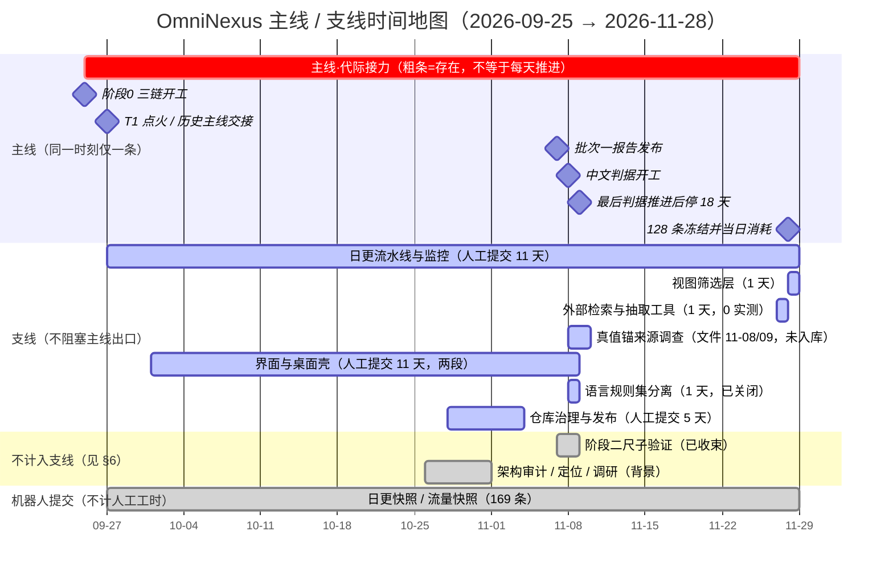
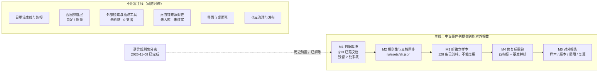

# ROADMAP · 主线 / 支线地图

> **最后更新：2026-11-28**（写入时 HEAD=`70d9908`，2026-11-28 20:31 +0900）
> **更新触发条件（任一满足即改本文件）**：① 主线换站（出口达成 / 被否决 / 被替换）；② 支线新增、关闭或升级；③ 主线最后一条人工提交日期变化；④ 某条支线超过 14 天未推进需要改状态。
> **过期规则：超过 14 天未更新，本文件即视为过期。** 过期地图比没有地图更危险——它会让人以为自己在看现状。过期后必须在标题下打 `[已过期]`，不得继续引用。

---

## 0. 两条硬规矩（先于一切）

1. **任何时刻只有一条主线。** 支线的定义是「不阻塞主线出口」，不是「有用」。有用但不阻塞出口的事，仍然是支线。
2. **本文件必须带最后更新日期，并写清更新触发条件。** 超过 14 天未更新即视为过期；过期的不只是日期，是整张图的信用。

---

## 1. 现在一眼看

| 项 | 事实（2026-11-28） |
|---|---|
| **当前主线** | 中文事件判据做到能对外报数（`phase0/timeline/` 的 `event_definition_zh.md` + `rulesets/zh.json` + 评测） |
| **主线当前卡在哪** | **M1/M2 之间**：判据补写已在 11-28 落文档（§13，15 条补句 + A2/S 层级），但 `rulesets/zh.json` 尚未同步；128 条样本已在本轮修复中被标记为 **CONSUMED**，不能再当独立样本 |
| **主线最后人工提交** | 2026-11-28 `70d9908`「docs: establish A2/S precedence and mark zh_fresh_20261128 as consumed」 |
| **主线出口** | 见 §2；五条同时满足才算到站，未达到不许换主线 |
| **最近 48 小时人工提交去向** | 11-27 共 3 条，全部不在判据出口上（日更降级记录、哨兵、取数↔判定契约）；11-28 共 12 条，其中直接服务出口 2 条（`8fcc0f6` 冻结 128 条、`70d9908` 判据补写），其余 10 条为取数层、视图层、日更/CI 与支线登记 |
| **当前在制品（未提交）** | `zh_fresh_20261128/labels_a.json`、`labels_b.json`、`criteria_audit.md`、`event_definition_hierarchy.md` 仍是 `??`（git 未跟踪）；`agreement.md` 已入库但已被标为「已用掉」 |
| **下一步唯一动作** | 先决定「新独立样本」怎么来，再动 M2；在判据版本冻结前，不要再用 128 条或 80 条改词表/阈值 |

### 1.1 为什么 11-28 看起来在推进，出口却没动

- 11-28 有 6 条提交落在 `phase0/timeline/`，但只有 `8fcc0f6` 直接服务出口（冻结样本）；`c24de68`/`f60a022` 是视图筛选层，`10200ce`/`fd93af0`/`425da06` 是取数层。
- 当天判据文档与规则集**在 20:31 之前没有改动**；`70d9908` 才补写 §13，并把 128 条标记为已消耗。
- 所以 11-28 的真实进度是：**样本冻结 → 样本被消耗 → 判据补写落文档**，不是「拿到了可对外报的数字」。

### 1.2 与委托清单的差异（以实物为准）

| 委托清单 | 实物差异 |
|---|---|
| 日更数据流水线与监控 | 仓库里没有独立的「监控支线」；哨兵、心跳、验证通道、`paths` 检查与日更流水线是同一组文件、同一条提交链（`tools/daily_sentinel.py`、`heartbeat_ping.py`、`.github/workflows/`），本表合并为一条 |
| 界面与桌面壳 | 实物是两段：M2 看板 2026-10-01→10-20，Tauri 桌面壳 2026-11-08；不是一条连续支线，本表合并但注明两段 |
| 真值锚来源调查 | `anchor_sources.md`、`anchor_check_b.md` 存在，但 `git status` 显示未跟踪；文件系统时间为 2026-11-08/09，**提交时间未核实**，不能当已入库证据 |
| 语言规则集分离 | 已于 2026-11-08 完成，不是待办支线；本表保留为「已关闭」条目，防止被重新当成新工作 |
| 视图筛选层 | 不在委托清单里，但 11-28 实际占用了主线时间，并把 80 条开发集重判后降级为回归集；不单列就会漏掉最近一次时间去向，故新增一条 |

---

## 2. 主线的唯一定义与出口判据

### 2.1 当前主线

**「中文事件判据做到能对外报数」**：在 `phase0/timeline/` 内，把中文「算不算一个事件」的判据写成可执行规则，用一份**未被本轮修复污染**的独立样本，给出可复算、可与基线并排、可对外独立阅读的数字。

主线不是「继续改进判据」，也不是「把界面做出来」。判据可以改，但只有为出口服务的改动才算主线推进；改完仍要回到出口。

### 2.2 出口判据（五条同时满足，缺一条不算到站）

1. **判据冻结且文档=代码。** `event_definition_zh.md` 的当前版本有裁决记录；`rulesets/zh.json` 与文档逐条对得上；已知的「文档说 A、代码做 B」不得留在出口里（现存残留见 §2.4）。
2. **一份新的独立样本。** 该样本不得参与过任何判据修订、词表调整或阈值选择；`zh_fresh_20261128`（128 条）与 `zh_samples`（80 条）均已被使用，只能作回归/开发集，不得再承当准确率或一致率结论。
3. **两次独立标注。** 对新样本做 A/B 两侧独立标注；报告给出三态一致率、κ、混淆矩阵、分歧清单，并明确「一致性 ≠ 准确率」。
4. **修复后重跑。** 用冻结后的判据版本在新样本上跑引擎，输出可复算的指标；不得用修复前数字，不得在重跑后回头改判据再报同一个数。
5. **数字与基准线并排。** 每个对外数字旁边必须有同算法基线（全判「不是」/全判「是」），并写明样本非随机、单窗口、来源不均、不可外推等局限；报告能独立阅读，附复算命令与文件哈希。

> 出口没达到就不许换主线。若出口判据本身要改，必须先改本节并记录日期与理由，不得在报告里临时改口径。

### 2.3 什么算换主线

- 出口达成、被作者明确否决，或出现更高优先级且不可并行的任务。
- 换站必须在本文件记录：旧主线去向（完成/暂停/关闭）、新主线出口、换站日期。
- 不允许「两条主线并行」；也不允许用「最近在做 X」代替换站记录。

### 2.4 当前已知的出口缺口（不是支线，是主线内部欠账）

| 缺口 | 证据 | 影响 |
|---|---|---|
| `rulesets/zh.json` 尚未按 §13 同步 | `70d9908` 只改了 `event_definition_zh.md`、`zh_fresh_20261128/README.md`、`agreement.md`、`manifest.json`，未改 `rulesets/zh.json` | 文档已写 A2/S 层级，引擎仍可能按旧逻辑跑；出口第 1 条不满足 |
| 128 条已被消耗 | `zh_fresh_20261128/README.md` 与 `agreement.md` 均标 `CONSUMED 2026-11-28T11:30:12Z` | 出口第 2 条不满足；必须另采新样本 |
| `criteria_audit.md` 与两侧标签未入库 | `git status` 显示 `??` | 读者能在 README 看到文件名，却点不到实物；外部不可核 |
| 两处层级冲突未裁 | `event_definition_zh.md` §13.6：`A2/Z15` 与 §2.5 `data_quality` 的管辖冲突；A（已发生）与 R12（承诺/指引）谁上位未写死 | 出口第 1 条的「文档=代码」仍可能有第二套读法 |
| 30 条巨潮只做了人工套用 | §13.4：26 条翻、4 条留，明确「未改代码、未跑引擎」 | 这是人工验证，不是引擎结果；不能当出口数字 |

### 2.5 历史主线交接（证明「同一时刻只有一条」）

| 代际 | 起止（人工提交日） | 出口/结果 | 交接 |
|---|---|---|---|
| 阶段 0 预注册三链判定 | 2026-09-25 → 09-27 | 3/3 未通过；尝试预算 3/3 用尽 | 转 T1 工程闭环 |
| T1 日更 + M2 看板 | 2026-09-27 → 10-31 | 连续 30 天日更；看板四页；Pages 上线 | 转批次一验证 |
| 批次一 临床 XBI / 能源 N1 | 2026-11-07 → 11-08 | 报告发布；两课题均未通过；留出段未开封 | 转中文事件判据 |
| **中文事件判据（当前）** | 2026-11-08 → 现在 | 未到站；128 条已消耗 | — |

> 11-10 → 11-26 判据线人工提交 0 条，已被 ERR-069 记为「18 天主线零推进」。这段空窗不能追补，也不假装补过。

---

## 3. 图一：甘特图（时间到底去哪了）

> 条形跨度 = 该线首次到末次证据日期，**不等于全时段投入**；括号内是人工提交日数。空白不代表没做，只代表没有提交记录。

**读图三条：**

1. **主线带是连续的，但里程碑只标了 6 个。** 连续只表示「主线这个位置一直存在」，不表示每天都在推进；11-10→11-26 那段没有任何主线里程碑，就是 ERR-069 记的 18 天空窗。
2. **支线里最长的一条是日更流水线与监控**（09-27→11-28，人工提交 11 天），其次是界面与桌面壳（10-01→11-08，11 天）。它们跨了多个主线代际，说明「旧主线降级为支线后不会自动消失」，会持续吃维护时间。
3. **机器人带几乎覆盖全程。** 169 条机器人提交让提交列表看起来每天在动；不看作者与路径，就会把「日更在跑」误读成「项目在推进」。

---

## 4. 图二：依赖图（谁真的卡住谁）

**读图三条：**

1. **MAIN 里只有 M1→M5 这一条前后置链。** 当前卡在 M1/M2 之间：文档补写完了，规则集还没同步；M3 的新样本也还没采。
2. **SIDE 组没有任何一条线连到 MAIN。** 这不是画漏：按当前出口定义，日更、视图、外部检索、真值锚、界面、仓库治理都不在关键路径上。它们可以随时停，停了不会让 M1–M5 断。
3. **唯一一条虚线是「语言规则集分离 → M1」，标的是已完成、已解除。** 它曾经是 11-08 判据开工的前置，现在不再阻塞。若哪天某条支线真的卡住 M1–M5 的某一环，才允许加实线，并在 §5 写清「卡的是哪一环」；加线当天必须更新本文件。

> 真值锚调查现在**不连**。只有当出口从「判据可复现」升级为「事实正确率 / 载体级核验」时，它才会变成 M5 的前置；那时再连线，并重写出口判据。

---

## 5. 支线判定表（7 条，均有升级条件）

| 支线 | 为什么是支线 | 什么条件下升级成主线 | 最后推进日期 | 超期怎么办 |
|---|---|---|---|---|
| **日更流水线与监控** | 保证「不断更、可审计」，但出口不检查 streak；11-27 的 3 条人工提交全在这条线上，判据 0 推进 | 出口要求「报告数字必须在连续 N 天线上环境复现」，或断更导致 M3 新样本无法在窗口内采集且无替代源；必须写明卡住 M3/M5 的哪一环 | 2026-11-28（`48a0779`、`6966bfd`、`e9255f3`、`d14d359`；11-27 为 `8b4835d`、`b51374c`） | >14 天无人工提交属正常（自动化在跑）；连续 3 天失败或哨兵连续 2 天红 → 升级为阻塞事件，暂停其他支线先止血；只修不加功能 |
| **视图筛选层（自足/增量）** | `view.*` 不改变 `is_event`；11-28 它让 80 条开发集重判并降级为回归集，属于消耗样本的展示层工作，不在出口五条里 | M1–M5 全部满足后，对外报告需要回答「哪些事件值得展开」；或用户明确要求展示层筛选且判据版本已冻结 | 2026-11-28（`c24de68`、`f60a022`） | 冻结在现定义，不再加维度；>14 天仍在改这一层而 M1–M4 未动 → 标「主线偏离」，停手回 M1 |
| **外部检索与抽取工具（未验证）** | 0 实测、0 支出；主线瓶颈是判据（口径 1 严格三态 61.25% < 75% 基线），不是取不到正文（支线文档 §2） | 三条同时满足：判据先站上基线并稳定；仍缺原文；需外部独立校验且 E3/E4 通过 | 2026-11-27（`c61b32b` 登记） | 已声明未排期，无「超期」概念；每 90 天复核一次是否仍封存；被引用时必须同句标「未验证、0 支出」 |
| **真值锚来源调查** | 它回答「事件是否真的发生」；当前出口只回答「标题是否算事件」。且 `anchor_sources.md`/`anchor_check_b.md` 未入库（`git status` 为 `??`），不能当对外证据 | 出口从「判据可复现」升级为「事实正确率/载体级核验」；或报告需要逐条证明事件真实发生 | 文件系统时间 2026-11-08/09；git 未跟踪，**提交时间未核实** | >14 天未入库 → 标「未核实」；>30 天未推进 → 关闭或重新立项；不得用其中数字支撑对外结论 |
| **界面与桌面壳** | 消费判据输出，不改变判据；界面完成不等于出口达标。实物是两段：M2 看板 10-01→10-20，Tauri 壳 11-08 | 对外交付形态必须是可点击桌面应用，且 `events.json` schema 冻结；或验收要求「在界面里复现报告数字」 | 2026-11-08（Tauri：`044b159`、`15cfdc1`、`86c8a76`、`1d506d6`、`acfc546`；M2 看板最后 10-20） | >30 天无推进 → 标「暂停」；只修阻断展示的 bug，不加交互；不得以界面完成度替代 M1–M5 |
| **语言规则集分离** | 2026-11-08 的一次性工程前置，已完成；不是持续支线 | 新增第三语言，或规则集边界导致 M1/M2 无法落地 | 2026-11-08（`9abffc5`、`e459adc`；i18n `0894dc2`、`fbb94ee`） | 已关闭，不计入活跃支线；若 14 天内被重新打开，必须新开条目并写触发原因 |
| **仓库治理与发布** | 交付卫生与公开可见性，不产出判据数字；10-28→11-03 的人工提交主要在这里 | M5 对外发布阶段，报告需要固定 URL/许可/README 说明；此时升级为发布前置，一次性完成 | 2026-11-03（Pages `0556c87`；10-31 README 拆分 `c3d53a6`） | >14 天未更新不算主线偏离；M5 启动前一次性补齐；Pages 失效 >7 天且报告依赖它 → 升级为发布阻塞 |

**计数：7 条进表，全部写了升级条件；0 条「没有升级条件却进表」。**

---

## 6. 被排除的条目（3 条，不进支线表）

> 没有「升级条件」的条目不是支线，是噪声。下面三条单独列出，说明为什么被排除——不是「没价值」，是「不能按支线管理」。

| 条目 | 为什么被排除 | 证据 |
|---|---|---|
| **阶段二判据尺子验证（探索性）** | 已收束的沙箱工作，不预注册、不进账本、不计尝试次数；它的产出是「尺子是否有效」的方法结论，不是当前出口。要让它成为主线，必须另立预注册课题并申请新预算——那是新项目，不是本条升级 | 2026-11-07 `f3a1a4b`；`phase0/controls/` 最后人工提交 2026-11-08 |
| **架构审计 / 产品定位 / 同类产品调研** | 背景文档生产，没有「完成」定义，也没有卡住 M1–M5 的环节；它解释了十月下旬的时间去向，但不是可执行支线。若将来要对外写定位说明，那是 M5 的子任务，不是本条升级 | 10-26→10-31 的相关提交（`954ff77`、`c342efb`、`3ba0e11` 等）；`docs/` 被 `.gitignore` 排除，文档本身无版本历史（ERR-054、ERR-059） |
| **用户行为推理分析** | 纯推演文档（N=1 口径），无代码、无判定线、无可复算产出；没有「升级成主线」的条件 | `docs/调研-用户行为推理分析.md`；项目记忆记为 N=1、不招募外部被试 |

---

## 7. 主线当前最大的偏离风险

**风险原句：把「样本」当成可无限重开的耗材，把「修复后重跑」做成样本内拟合。**

具体机制：

- `criteria_audit.md` 的 15 条补句，全部来自 `zh_fresh_20261128` 这 128 条的 20 条分歧；`70d9908` 已经据此改了 `event_definition_zh.md`，并把 128 条标成 **CONSUMED**。
- 这是正确的处理——它承认了「发现缺陷的样本不能再证明修复有效」。但下一步如果继续用这 128 条调 `rulesets/zh.json`、调词表、调阈值，再拿它跑出一版数字，那么「修复后重跑」仍然不是独立检验，只是把同一次拟合换了个文件名。
- 更早的 80 条已经在 11-28 被视图层重判一次、降级为回归集。现在 128 条也被用掉。**项目手上已经没有第三份未触碰的中文样本。**
- 如果新样本采回来之前判据还在动，新样本一落地就会被下一轮修复消耗；样本永远追不上判据，出口会一直看起来「快到了」。

**可执行的拆法（二选一，必须显式选）：**

1. **先冻结，再采样**：把当前判据版本（含 §13）冻结为 `vX`，先采一份新窗口样本并冻结 SHA；在看见新样本之前不再改判据。看见新样本后，只允许按预注册的判定口径跑一次，不允许回头改词表。
2. **降级出口**：如果做不到 1，就把出口从「准确率」降为「回归验证」——明确写「本报告只证明版本之间没有漂移，不证明判据准确」，并且不对外使用「准确率/一致率」字样。

**不能做的事：** 既用新样本修判据，又用同一份新样本证明修好了；把 128 条的回归结果换个标题当对外数字；用「一致性 84.4%」当判据质量。

---

## 8. 证据与口径（这张图凭什么这么画）

- **日期口径**：`git log --date=short`，人工提交按作者 `An0319` 计；HEAD 上人工提交 141 条、机器人 `github-actions[bot]` 169 条、合计 310 条。11-07→11-28 抽查作者时间与提交时间一致；更早的提交未逐条比对，跨时区可能差一天。
- **「人工提交日」**：一天只计一次，同一天多条提交不重复计；同一天服务两条线的，两条线各计一次，所以各行相加会大于总天数。
- **主线与支线归属**：按提交实际改动的路径与文件判定，不按提交信息里的「docs/feat」字样判定。同一提交跨两条线的，归到它直接服务的那条；无法判定的不强行归属。
- **实物来源**：
  - 主线：`phase0/timeline/event_definition_zh.md`、`rulesets/zh.json`、`phase0/timeline/benchmark.md`、`phase0/timeline/zh_fresh_20261128/`（`README.md`、`manifest.json`、`agreement.md`、`criteria_audit.md`、`labels_a.json`、`labels_b.json`）
  - 支线：`phase0/timeline/支线-未验证-外部检索与抽取工具.md`、`phase0/timeline/anchor_sources.md`、`phase0/timeline/anchor_check_b.md`、`phase0/timeline/zh_source_access.md`、`phase0/timeline/contract_fetch_to_judge.md`、`phase0/timeline/view_filter_definition_zh.md`、`phase0/数据口径-降级接受记录.md`
  - 历史：`docs/错账-已发现的错与被推翻的判断.md`（ERR-069 记 18 天空窗；ERR-054/059 记 `docs/` 无版本历史；ERR-066 记 B 池 118 条无实物）
- **未核实项**（不编）：
  - `anchor_sources.md`、`anchor_check_b.md`、`zh_fresh_20261128/criteria_audit.md`、`labels_a.json`、`labels_b.json`、`event_definition_hierarchy.md` 均为 git 未跟踪；其日期只能取文件系统时间，**提交时间未核实**。
  - `docs/` 整体被 `.gitignore` 排除，`docs/` 内文档的改动时间无 git 历史可核。
  - 11-28 之后若 HEAD 继续前进，本文件的「最后人工提交」与「当前卡点」会立即过期；使用前先跑 `git log -5 --date=iso` 对照。
