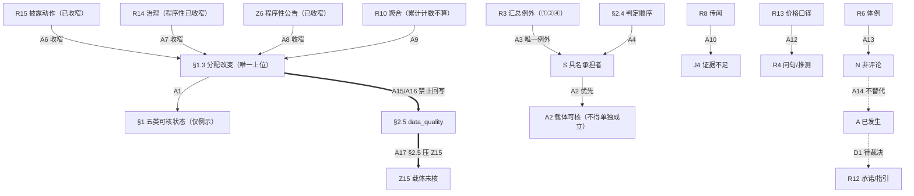

# 事件判据 · 层级关系图（2026-11-28）

> **状态：本文件为判据层级关系图；D1 尚未裁决，D2 已按 2026-11-28 裁决写定。**
> 覆盖对象：`phase0/timeline/event_definition_zh.md`。每条箭头都注明出处（S 编号或条文编号），没有出处的箭头不画。
> 图中「实线」= 已写死；「虚线」= 尚未写死，只登记、不假装有结论。

## 1. 结构图

```text
§1.3 分配改变（唯一上位判准）
│
├─[A1] 取代/例示──> §1 五类外部可核状态（登记/监管/交易资金/任职/公开记录）
│                    出处：S076、S123
│
├─[A2] 优先于──────> A2 载体可核（A2 不得单独成立，不得替代 S）
│                    出处：S067、S086
│
├─[A3] 唯一例外────> S（具名承担者）：R3 三项齐备时，集体主体可通过 S
│                    三项 = ①发布主体可指认 ②时段/单位可查 ④统计范围可查
│                    ③归属已移出（归分池）
│                    出处：S041、S049、S044；条文 R3
│
├─[A4] 判定顺序────> N → S → A/A2 → R10 → T（§2.4）
│  └─[A5] 同句冲突：不算 优先于 判不了
│                    出处：S044
│
├─[A6] 收窄────────> R15（须有已完成决议动词；纯文件名/文种不适用）
│                    出处：S110、S026
├─[A7] 收窄────────> R14（程序性部分；实质治理不动）
│                    出处：S110、S026（§13.5）
├─[A8] 收窄────────> Z6（仅文件名/文种且无决议动作 → 不是）
│                    出处：S110、S026（§13.5）
│
├─[A9] 改写────────> R10（只管逐个列举；累计计数不构成聚合）
│                    出处：S041、S069
├─[A10] 压过───────> J4（R8 命中即不是，不与「证据不足」互换）
│                    出处：S039、S092
├─[A11] 扩义───────> R8 的「具名确认」包含摘要中具名机构通报
│                    出处：S114
├─[A12] 先于───────> R4 / R2（价格条目先走 R13 口径，不因问句改判不是）
│                    出处：S066、S100
├─[A13] 压过───────> N（「解读/分析」标签不压冒号后的已完成事实）
│                    出处：S070
├─[A14] 不等于─────> A（N 的「主句事实优先」不替代 A/§1.3）
│                    出处：S063
│
├─[A15] 禁止回写───> pool ↛ is_event
│                    出处：条文 §2.5 硬约束 2
├─[A16] 禁止回写───> data_quality ↛ is_event
│                    出处：条文 §2.5 硬约束 2
├─[A17] 压过───────> Z15（载体未核只改 data_quality，不改 is_event）
│                    出处：2026-11-28 裁决（§2.5 上位）
│
└─[D1] 未定（虚线）─> A（已发生） ⟂ R12（有执行权的未来承诺判是）
                     出处：条文 §2.2 A / §2.3 R12；§13.6
                     状态：待用户裁决
```



## 2. 箭头清单（出处逐条）

| # | 起点 → 终点 | 关系 | 出处 |
|---|---|---|---|
| A1 | §1.3 → §1 五类状态 | 取代；五类仅作例示 | S076、S123 |
| A2 | S → A2 | S 优先；A2 不得单独成立、不得替代 S | S067、S086 |
| A3 | R3 → S | **S 的唯一例外**：同时满足 ①②④ 时，集体主体可通过 S；③ 归属已移出，归分池 | S041、S049、S044；条文 R3 |
| A4 | §2.4 判定顺序 → S/A/A2/R10 | N → S → A/A2 → R10 → T | §2.4 |
| A5 | 「不算」→「判不了」 | 同句冲突时不算优先 | S044 |
| A6 | §1.3 → R15 | 收窄：须有已完成决议动词 | S110、S026 |
| A7 | §1.3 → R14 | 收窄：程序性部分不再默认「是」 | S110、S026；§13.5 |
| A8 | §1.3 → Z6 | 收窄：纯文件名/文种 → 不是 | S110、S026；§13.5 |
| A9 | §1.3 → R10 | 累计计数不构成多事件聚合 | S041、S069 |
| A10 | R8 → J4 | R8 命中即不是，不得与「证据不足」互换 | S039、S092 |
| A11 | R8 的「具名确认」 | 扩义到摘要中具名机构通报 | S114 |
| A12 | R13 → R4/R2 | 价格先判口径，不因问句改判不是 | S066、S100 |
| A13 | R6 → N | 「解读/分析」标签不压冒号后的已完成事实 | S070 |
| A14 | N → A | 主句事实优先不替代 A/§1.3 | S063 |
| A15 | pool ↛ is_event | 禁止回写 | §2.5 硬约束 2 |
| A16 | data_quality ↛ is_event | 禁止回写 | §2.5 硬约束 2 |
| A17 | §2.5 → Z15 | **实线**：载体未核只改 data_quality，不改 is_event | 2026-11-28 裁决（§2.5 上位） |
| D1 | A ⟂ R12 | **虚线**：已发生 vs 未来承诺，待用户裁决 | §2.2 A / §2.3 R12；§13.6 |

## 3. 虚线与已定边

- **D2 已定（A17）**：原「Z15 载体未核 → 判不了」与「§2.5 data_quality 不回写 is_event」冲突。2026-11-28 裁决 **§2.5 上位**：载体核不核过影响的是**证据质量**，不是**世界有没有变**；让数据质量否决事件判定，等于把「我们没核实」伪装成「它没发生」。原则：**看不清 ≠ 没发生。** Z15 只影响 `data_quality`。
- **D1 仍未定**：A 要求「消息发布前已经完成」，R12 把有执行权的未来承诺判 `是`。§1.3 的「已公开的拟议」只覆盖有公告载体的情形，管不到高管口头指引。这是**产品判断**，待用户裁决；本图保持虚线，不替用户定。

## 4. 这张图里最可能被判错的一处

**A3（R3 → S 的唯一例外）。**

1. 它是全图**唯一**允许集体主体通过 S 的缺口，误用会让 `我国/行业/多家` 成批变「是」。
2. 拆掉 ③ 之后仍有三项，性质并不相同：① 发布主体可指认是**机械可核**（白名单逐字命中）；② 时段/单位可查、④ 统计范围可查都是**读标题判断**。三项混在一句里，正是它们会被抽签执行的原因。
3. 样本已证明它会分叉，且分叉原因不同：
   - **S041**：①②④ 都过（国资委/去年以来/央企范围）→ 过 S；但 **A 不过**（累计项目数，无离散分配）→ 不是。
   - **S049**：① 不过（只有「数据显示」＋媒体，无具名发布主体）→ 不是。
   - **S044**：① 不过（只有「我国」）→ 不是。
   三条结论同为「不是」，但**不是因为同一条**：S041 卡在 A，S049/S044 卡在 ①。结论一致不等于机制一致。
4. 它没有 A2/S 的「无主体即不算」硬闸，也没有 R10 的「逐个列举」可操作判据；②④ 只能靠读标题。

次风险是 **D1**：它不是「难判」，是产品判断未定，任何实现都会随机落到一边。

## 5. 边界

- 本图是**描述现状 + 标出未定边**，不是新判据；不改变任何 `is_event` 结论。
- 未改代码、未调词表、未跑评测。
- A3/A4 等结构边只做核对，不新增规则。
